# Personal Hybrid Quant — Personal Quant Trading Assistant (PQTA)

## Project Overview

This repository contains a historical market-data and research foundation plus
the Personal Quant Trading Assistant (PQTA), a local **historical** candlestick
preview. The longer-term project is multi-asset and hybrid statistical/ML;
the implemented application is currently limited to Binance Spot BTC/USDT 1h
Silver data. It is not a live trading system.

## Project Objectives

- Preserve and validate UTC hourly market history with explicit gap and source
  provenance.
- Support reproducible, gap-aware statistical research and a local visual
  inspection workflow without overstating point-in-time availability.
- Develop future analysis and decision support only after separate research,
  data-eligibility, and project-owner approvals. Any trading execution remains
  manual; automated exchange orders are outside the project boundary.

## Current Implementation Status

| Task ID | Task name | Current status | Brief description |
| --- | --- | --- | --- |
| QNT-000 | Repository foundation | Complete | Python package, documentation, and tests. |
| QNT-001 | Historical ingestion | Complete, with documented gaps | Binance Spot 1h BTC/USDT, ETH/USDT, and SOL/USDT Bronze/Silver pipeline. |
| QNT-001B | Archive verification | Complete | Published Binance monthly archives checked against local history. |
| QNT-001C | Anomaly investigation | Complete; causes unresolved | REST/archive discrepancy and shortened-close observations documented. |
| QNT-002A | Gap-aware EDA | Complete | Descriptive BTC/USDT research artifacts in local Gold. |
| QNT-002B | Feature engineering | Complete; research-only | Seven-feature engine, candidate anomaly manifest, and audited local Gold snapshot. |
| QNT-003A–D | Statistical research design | Complete; no evaluation run | Protocol `qnt-003d-design-v1` defines, but has not executed, baseline/Ridge comparisons. |
| PQTA-001 | Local candlestick preview | Complete and regression-tested | Read-only chart with `Analyze Now` refresh and constant `NO SIGNAL`. |
| PQTA-001A/B/C | Environment diagnosis and recovery | Complete and regression-verified | Dedicated arm64 Python 3.12 Conda environment; full 99-test regression passed. |
| PQTA-002A | Shared feature inspection | Complete; design only | Identified the QNT-002B engine as the single formula source and approved adapter boundaries. |
| PQTA-002B | Shared feature adapter | Complete; architecture-approved and pushed to main | Validates supplied in-memory BTC/USDT candles and reuses the offline engine; no fresh-data fetch or application integration. |
| PQTA-002 | Shared Feature Pipeline | Partial; not operational in the chart | Offline adapter complete; fresh-data sourcing, chart integration, and inference remain future work. |
| PQTA-003A | ML research and dataset inspection | Complete; read-only | Reviewed the governing protocol and local source/feature metadata; no target or evaluation was produced. |
| PQTA-003B | Research dataset and ML architecture | Complete — Architecture Approved (Design Only) | Proposed research-only origin, forecast, and score contracts; no implementation or evaluation. |
| PQTA-003C | Research-only origin dataset | Complete — Architecture Approved (Research Dataset Only) | Pinned Silver/Gold/manifest audit, next-hour target, split and quality masks, and immutable local origin ledger; no forecasts or evaluation. |
| PQTA-003 | ML Training & Evaluation | Planned; not implemented | The origin ledger is not an approved training dataset; fitting and retrospective evaluation require separate authorization. |
| PQTA-004 | Signal Decision Engine | Planned; not operational | Future decision policy; the chart currently reports `NO SIGNAL`. |
| PQTA-005 | Chart Signal Integration | Planned; not operational | Future chart markers; none are displayed today. |
| PQTA-006 | On-Demand Fresh Analysis | Planned; not operational | Future fresh-data analysis; `Analyze Now` currently refreshes local history only. |
| PQTA-007 | Paper Trading | Deferred; not operational | Future simulation subject to separate approval; no orders are placed. |

The seven implemented BTC/USDT features are `log_return_1h`,
`volatility_24h`, `volatility_168h`, `momentum_24h`, `momentum_168h`,
`volume_change_1h`, and `normalized_range_1h`. See the
[feature contract](docs/QNT-002B_FEATURE_CONTRACT.md) and
[real-data audit](docs/QNT-002B_REAL_DATA_AUDIT.md).
The [QNT-003 final research design](docs/QNT-003D_FINAL_RESEARCH_DESIGN.md)
specifies zero-return, expanding-mean, and AR(1) baselines plus a seven-feature
Ridge comparator; it reports no predictive evaluation or performance.

## System Architecture

Solid arrows below represent implemented historical/offline paths. Dotted
arrows and every component in the Planned group represent future work only.

```mermaid
flowchart LR
  subgraph implemented["Implemented — historical and local"]
    source["Binance Spot historical OHLCV"] --> bronze["Bronze Parquet"]
    bronze --> silver["Silver Parquet"]
    silver --> eda["QNT-002A EDA"] --> goldeda["Gold research artifacts"]
    silver --> features["QNT-002B seven-feature engine"] --> goldfeatures["Gold research-only features"]
    manifest["Versioned candidate anomaly manifest"] --> features
    silver --> origins["PQTA-003C research-only origin ledger"]
    goldfeatures --> origins
    manifest --> origins
    supplied["Supplied in-memory BTC/USDT OHLCV; no fetch"] --> adapter["PQTA-002B shared validation adapter"] --> features
    silver --> preview["Read-only historical preview backend"]
    preview --> http["Loopback HTTP application"] --> chart["TradingView Lightweight Charts frontend"]
  end
  subgraph planned["Planned — not operational"]
    approveddata["Future separately approved training dataset; not current Gold or origin ledger"] -.-> training["ML training and evaluation"]
    training -.-> savedmodel["Saved model"]
    ondemand["Future on-demand fresh analysis"] -.-> fresh["Fresh market data"]
    fresh -.-> validation["Fresh-data validation"]
    validation -.-> sharedfeatures["Shared feature engineering"]
    sharedfeatures -.-> inference["ML inference"]
    savedmodel -.-> inference
    inference -.-> decisions["Signal decision engine"]
    decisions -.-> markers["BUY/SELL chart markers"]
    decisions -.-> paper["Paper trading"]
  end
  origins -.-> approveddata
  chart -.-> ondemand
```



The implemented Silver-to-feature-engine path is historical and offline. Its
current Gold snapshot is **not** the future approved training dataset. The
new adapter calls that same engine on explicitly supplied, validated in-memory
candles; it is not connected to the chart or an exchange. The planned training
path requires separate dataset eligibility and authorization;
only its saved model would feed future inference. The current `Analyze Now`
action rereads Silver and does not retrain or run any model.

PQTA-003C constructs a separate local, research-only origin ledger from the
pinned Silver, Gold, and candidate manifest. It carries retrospective
next-hour target and quality audit fields, not a forecast or an approved
training dataset. Outcome-side fields are excluded from its allowlisted
forecast-side view. No baseline, Ridge fit, prediction, score, or backtest ran.
See the [dataset implementation report](docs/PQTA-003C_DATASET_IMPLEMENTATION.md).

The QNT research architecture proposes eventual statistical/ML research,
signals, risk assessment, a dashboard, and **manual** trading. The local chart
does not implement that future decision path. See [ARCHITECTURE.md](docs/ARCHITECTURE.md)
and [DECISIONS.md](docs/DECISIONS.md) before changing it.

The longer-term proposed flow continues from market data through Bronze,
Silver, Gold, research, signal generation, risk assessment, a dashboard, and
manual trading.

## Technology Stack and Versions

Versions below were checked in the local `pqta` environment and frontend
installation; unpinned package versions can change on a future install.

| Component or layer | Technology | Installed or declared version | Purpose | Implementation status |
| --- | --- | --- | --- | --- |
| Environment | Anaconda / Conda | 24.11.3 installed | Isolated local development environment | Used for `pqta` |
| Runtime | Python | 3.12.15 installed; `>=3.12` declared | Backend, research, tests | Implemented; native macOS arm64 |
| Market ingestion | CCXT | 4.5.89 installed; unpinned declaration | Historical Binance Spot API access | Implemented historical ingestion; **not used by the chart** |
| Tabular processing | Polars | 2.0.0 installed; unpinned declaration | Bronze/Silver, feature, and research-ledger transformations | Implemented in QNT and PQTA-003C workflows |
| Query and preview | DuckDB | 1.5.6 installed and pinned | Parquet queries and read-only chart window | Implemented |
| Storage format | Parquet | Format; no separate package version | Local Bronze/Silver/Gold files | Implemented |
| Validation dependency | Pandera | 0.34.1 installed; unpinned declaration | Declared validation library | Installed but not imported by current source |
| Timezone dependency | pytz | 2026.5 installed; unpinned declaration | Declared timezone library | Installed but not imported; code uses UTC from Python stdlib |
| Local HTTP | Python standard library | Python 3.12.15 | Loopback-only preview server | Implemented |
| Frontend tooling | Node.js / npm | 22.13.1 / 10.9.2 installed locally | Install pinned chart asset | Used for local frontend setup; not Python dependencies |
| Chart frontend | TradingView Lightweight Charts | 5.2.1 declared and installed locally | Interactive dark-theme candlesticks | Implemented |
| Tests / lint | pytest / Ruff | 9.1.1 / 0.17.1 installed | Regression tests / lint and format | Implemented |
| Build backend | Hatchling | Declared without version pin; not installed in `pqta` runtime | Editable package build in isolated build environment | Build-time only |
| Future modeling | Ridge design; LightGBM / XGBoost proposals | Not declared or installed in `pqta` | Possible later predictive research | **Planned only; no model execution** |
| Future interface proposal | Streamlit | Not declared or installed in `pqta` | Earlier dashboard proposal | **Planned only; current chart does not use it** |

The Python declarations are in [pyproject.toml](pyproject.toml); the chart
version is pinned in [web/package.json](web/package.json) and
[web/package-lock.json](web/package-lock.json). No ML library is required to
run the current chart.

## Data Architecture

- **Bronze:** local Parquet preserves source observations and revisions from
  historical ingestion.
- **Silver:** validated, deduplicated canonical hourly candles with UTC
  timestamps. The current chart reads only the existing BTC/USDT Silver file,
  never writing it or fetching fresh candles.
- **Gold:** QNT-002A descriptive EDA artifacts and the QNT-002B seven-feature
  BTC/USDT snapshot. Both are local research outputs, not chart inputs.
- **Research ledger:** PQTA-003C joins the pinned Silver and Gold timelines by
  exact UTC candle open, preserving all seven features and Gold eligibility.
  Its local `data/research/pqta-003/` origin ledger includes a next-hour
  target and audit masks but no forecast, score, fit, or model artifact.
- **Quality evidence:** coverage reports distinguish verified gaps from
  unknown coverage; the versioned candidate anomaly manifest remains separate
  from Silver and does not repair OHLCV values.

The shared adapter accepts strictly ordered BTC/USDT 1h candle opens, local
observation times, and finite OHLCV, plus explicit analysis and expected-latest
boundaries and a versioned anomaly manifest. It rejects duplicates, out-of-order
or incomplete candles, invalid values, and a stale latest candle. It returns
the existing typed seven-feature Gold schema **in memory**, with explicit
internal missing hours, null reasons, and 24/168-hour warm-up after gaps. It
does not write a dataset. Its `source_snapshot_sha256` hashes canonical
in-memory observation bytes, **not** Silver Parquet bytes; adapter rows identify
this provenance with `feature_version=qnt-002b-v1+pqta-canonical-ohlcv-v1`.
The canonical UTF-8 JSON includes schema ID, fixed market identity, ordered
field names, and ascending rows; UTC times use six fractional digits and `Z`,
while numeric values use exact big-endian IEEE-754 Float64 hex bytes. JSON
keys are sorted, separators compact, and a final newline is included.
An empty anomaly list never proves complete quality; without verified manifest
availability, feature values can be inspected but `available_at` stays null
and `decision_eligible` is false. The adapter also rejects observation or
quality evidence later than `analysis_as_of`; the expected latest candle must
be the latest full hour closed at that boundary. Candle closure alone is not
publication evidence. Future fresh-data evidence and inference require
separate approval.

Historical Gold has unknown publication availability (`available_at=null`),
unresolved anomaly evidence, and zero `decision_eligible` rows. It does **not**
establish verified point-in-time trading eligibility and is not approved for
trading or backtesting. Data and generated reports remain local and ignored by
Git. See [PROJECT_CONTEXT.md](docs/PROJECT_CONTEXT.md).

## Application Workflow

1. Start the local server from the repository root. It reads a bounded window
   from the existing Silver BTC/USDT Parquet in read-only mode.
2. The backend checks OHLCV, UTC hour alignment, duplicates, candle closure,
   and gaps, then returns chronological chart candles or an explicit error.
3. The browser displays a dark, interactive 1h chart, latest candle time,
   source and quality status, and `HISTORICAL PREVIEW — NOT LIVE`.
4. `Analyze Now` rereads that **same local history** and refreshes the chart.
   It does not run a model, request Binance data, or generate a signal.

The signal status is always `NO SIGNAL`; no BUY/SELL markers or order route
exist.

## Repository Structure

| Path | Role |
| --- | --- |
| `src/quant/ingestion/`, `src/quant/validation/` | Historical collection, canonicalization, archive and coverage checks. |
| `src/quant/research/`, `src/quant/features/` | BTC/USDT descriptive EDA and offline feature calculations. |
| `src/quant/app/`, `web/` | Read-only Python preview server and browser chart. |
| `tests/`, `.github/workflows/` | Offline regression tests and CI workflow. |
| `configs/`, `docs/` | Availability/anomaly configuration and research decisions/reports. |
| `data/bronze/`, `data/silver/`, `data/gold/`, `data/research/` | Ignored local datasets and research artifacts. |
| `notebooks/`, `scripts/` | Exploratory workspace and bounded research utilities. |

`src/quant/strategies/`, `src/quant/models/`, and
`src/quant/backtesting/` contain placeholders, not implemented trading or
model pipelines. Notebooks are exploratory; production logic belongs in
`src/quant/`.

## Installation and Environment Setup

From the repository root on macOS arm64, with Anaconda and Node/npm available,
create the environment **once** on verified local storage outside cloud-offloaded
folders (skip creation if `pqta` already exists):

```bash
conda create -n pqta python=3.12 pip
eval "$(conda shell.zsh hook)"  # initialize this shell; no config change
conda activate pqta
python -m pip install -e '.[dev]'
npm ci --prefix web --ignore-scripts
```

The project pins DuckDB 1.5.6 for verified regression compatibility. The
existing `.venv` and temporary PQTA-001B environment do not need removal.
The frontend package is installed under ignored `web/node_modules/`; there is
no CDN dependency. See [web/README.md](web/README.md) for practical usage.

## Running the Application

With `pqta` active, run from the repository root:

```bash
python -m quant.app
```

Open <http://127.0.0.1:8765> and stop with Ctrl-C. The default source is
`data/silver/binance/1h/BTC-USDT.parquet`; the server binds only to loopback.
Use `--data-root`, `--port`, or `--limit` when needed; `--limit` defaults to 500
and is capped at 2,000 candles. The preview does not create or modify data.

## Testing and Validation

With `pqta` active, run from the repository root:

```bash
python -m pytest -q
ruff check .
ruff format --check .
python -m pip check
```

The PQTA-001 environment verification passed 15 PQTA tests, 84 QNT tests,
and all 99 tests together. The current PQTA-002B local regression passed 122
tests, including the new synthetic adapter tests; Ruff lint/format and
`pip check` passed. PQTA-002B was architecture-approved and pushed to main.
PQTA-003C added 44 synthetic dataset tests; the full local suite passed 166
tests, Ruff lint/format and `pip check` passed. Its pinned historical ledger
passed acceptance and an identical rerun reused the same artifact bytes.
Tests use synthetic data and local fixtures; the HTTP test
binds a temporary localhost
port. The prior QNT-002B CI run passed its then-current 84-test suite; it did
not validate the later PQTA application. Existing Bronze, Silver, and Gold
files were not regenerated by the environment verification.

## Current Limitations

- This is a historical Silver preview, not fresh or live Binance data. Its
  displayed candles are not verified point-in-time trading inputs.
- Known historical gaps and source discrepancies remain documented and
  unresolved; the chart reports gaps rather than filling them.
- Gold and the PQTA-003C origin ledger are research-only; historical feature
  availability and decision eligibility are not established for trading or
  backtesting. The ledger's target and anomaly masks are retrospective audit
  fields, not a point-in-time-verified training sample.
- `Analyze Now` refreshes the preview only. No ML predictions, BUY/SELL/HOLD
  recommendations, chart markers, paper trades, brokerage connection, or
  automated order execution are implemented.
- QNT-003 specifies a research protocol, not predictive findings. Lane A
  evaluation needs separate approval; verified point-in-time Lane B remains
  blocked. No model performance or profitability claim is made.

## Development Roadmap

PQTA-001 is the implemented, regression-tested local chart foundation.
PQTA-002A inspected the architecture and PQTA-002B completed the offline
shared adapter. PQTA-003A completed read-only inspection; PQTA-003B has a
[research dataset and ML architecture design](docs/PQTA-003B_ML_ARCHITECTURE_DESIGN.md).
Its status remains Complete — Architecture Approved (Design Only). PQTA-003C
implemented its research-only origin ledger and next-hour target; no approved
training dataset, fit, forecast, or score has been produced. Later
integrations remain non-operational:

- **PQTA-002 — Shared Feature Pipeline:** the adapter reuses the existing
  engine; fresh-data sourcing and chart/inference integration are not built.
- **PQTA-003 — ML Training & Evaluation:** future training on an approved
  dataset, with a saved model for separately authorized inference.
- **PQTA-004 — Signal Decision Engine:** future policy for model outputs.
- **PQTA-005 — Chart Signal Integration:** future BUY/SELL marker display.
- **PQTA-006 — On-Demand Fresh Analysis:** future fresh-data analysis initiated
  by the user; today's button only reloads historical Silver.
- **PQTA-007 — Paper Trading:** deferred simulation, with no live orders.

The manual-only execution boundary remains in force; this roadmap authorizes
none of those components. QNT-003 statistical evaluation also requires
separate approval.

For each future PQTA task, update this README when architecture changes,
dependencies or their versions change, task status changes, or setup commands
change. Keep implemented and planned functionality distinct and verify claims
against the repository and installed environment.

## Historical OHLCV ingestion

Review planned requests without fetching or writing anything:

```bash
python -m quant.ingestion --symbols BTC/USDT ETH/USDT SOL/USDT --backfill --dry-run
```

Run the approved backfill from 2021-01-01 UTC to the latest fully closed hour:

```bash
python -m quant.ingestion --symbols BTC/USDT ETH/USDT SOL/USDT --backfill
```

Resume from the latest stored Silver candle, rechecking the preceding 24 hours:

```bash
python -m quant.ingestion --symbols BTC/USDT ETH/USDT SOL/USDT --incremental --overlap-hours 24
```

`--start`, `--end`, and `--end-exclusive` accept UTC ISO 8601 timestamps on
hour boundaries. The existing `--end` denotes an **inclusive candle open**;
`--end-exclusive` uses `[start,end)` and is mutually exclusive with `--end`.
The last included candle must be fully closed. Only `1h` is supported.
`--page-size` (1 to 1000, default 1000) bounds each provider call. Exit status
2 means at least one requested window contains gaps; status 1 means a
fetch or storage failure. A dry run prints the intended window and page count,
without creating an exchange client or writing files.

Raw revision events are kept in `data/bronze/binance/1h/`; canonical
valid records are in `data/silver/binance/1h/`. Quality reports appear in
`data/reports/binance/1h/`. All data and reports are ignored by Git. Run from
the repository root or set `--data-root` explicitly. Bronze retains revisions
and value reversions; Silver chooses the latest observed valid revision. Empty
API pages and missing hours are reported as incomplete coverage, with no
forward filling.
Expected, observed, and legacy `missing_candle_count` cover the requested
window. The report also gives `requested_end_exclusive`, first and last valid
Silver candles, `unobserved_timestamps`, `missing_timestamps`, and separate
counts/periods for verified
gaps, pre-availability, and unknown coverage. `missing_candle_count` retains
its original meaning of **all unobserved requested hours** for compatibility;
`missing_timestamps` lists only gaps within verified availability.
`ingestion_status` remains `incomplete` whenever requested hours are
unobserved; `coverage_status` explains whether the gap is verified missing,
unknown, or before verified availability.

The per-symbol [availability file](configs/availability.json) starts with no
verified dates. A first API candle is not treated as a listing date. To enter
a verified first available hourly candle, record its UTC hour and a traceable
source in `verified_start_utc` and `evidence`. If listing occurred partway
through an hour, use the first *fully available* hourly candle. Without this
evidence, unobserved hours are classified as unknown. If data precedes the
recorded start, the report flags an availability conflict. You can select an
alternate evidence file using `--availability-config`.

For a bounded seven-day example, ending at the completed 2026-10-20 UTC day
boundary, use:

```bash
python -m quant.ingestion --symbols BTC/USDT --backfill \
  --start 2026-10-13T00:00:00Z --end-exclusive 2026-10-20T00:00:00Z \
  --page-size 48
```

The report records actual fetched page and observation counts. Duplicate,
revision, and rejected counts cover stored Bronze observations for the symbol
(plus exact repeats seen in the current fetch); the other coverage counts are
for the requested window.

Inspect Silver locally with DuckDB:

Set the DuckDB session timezone to UTC when displaying timestamp values;
the Parquet timestamp column has UTC timezone semantics.

```bash
python -c "import duckdb; db=duckdb.connect(); db.execute(\"SET TimeZone='UTC'\"); print(db.execute(\"SELECT min(timestamp), max(timestamp), count(*) FROM 'data/silver/binance/1h/BTC-USDT.parquet'\").fetchall())"
```

Offline tests use mocked exchange responses:

```bash
python -m pytest
ruff check .
```
